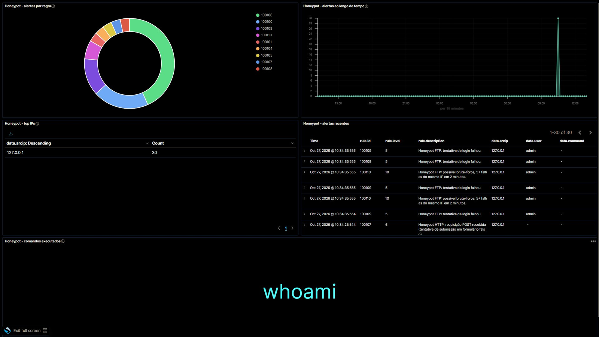
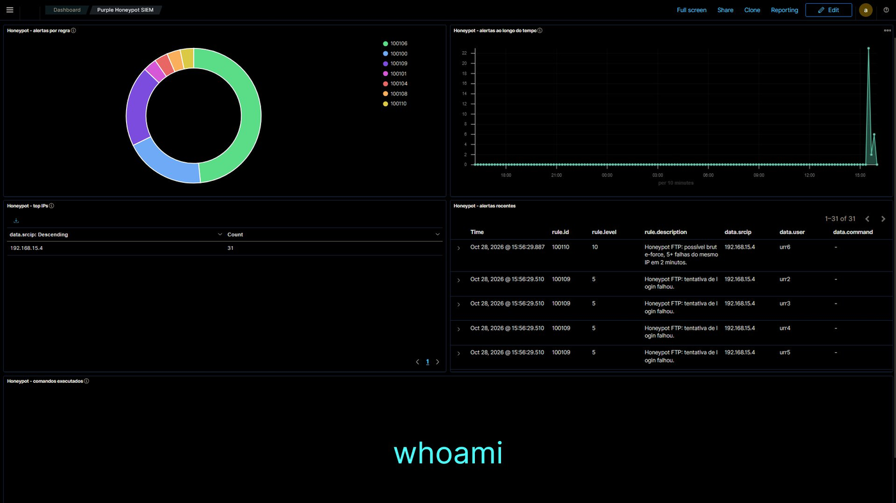
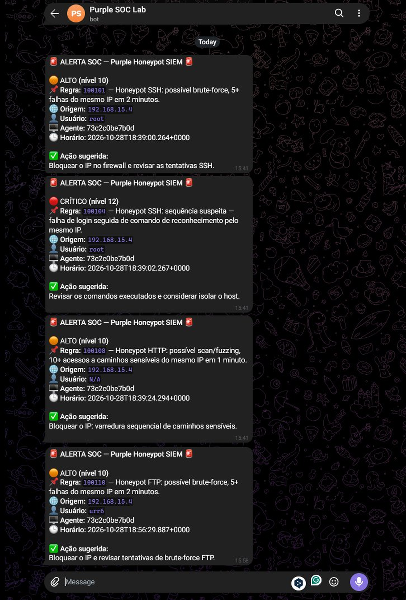

# Purple Honeypot SIEM


Pipeline de telemetria e detecção para **Blue Team / Purple Teaming**: três honeypots em Python (SSH, HTTP e FTP) geram eventos JSON, o Wazuh aplica **11 regras de correlação customizadas** e o alerta chega ao Telegram. O Wazuh Dashboard consolida a triagem em cinco painéis.

> **Escopo:** laboratório reproduzível com Docker Compose. Wazuh 4.7.2, testado no Windows (Docker Desktop e Git Bash) e em um clone limpo no Linux. Não é uma configuração de produção.

## O que este projeto entrega

- **Honeypot SSH real** com Paramiko: handshake compatível com OpenSSH, autenticação simulada e captura de comandos em um shell falso.
- **Honeypot HTTP** com iscas (`/.env`, `/admin`, `/.git`, `/backup`) e captura de método, caminho, User-Agent e corpo.
- **Honeypot FTP** com banner, autenticação simulada, `LIST` e `RETR` de arquivo fictício.
- **Ingestão estruturada** dos três logs JSON no Wazuh via `localfile`, com timestamp UTC.
- **Detecção própria**: brute-force SSH/FTP, reconhecimento SSH, sequência falha → reconhecimento, login externo, scanner HTTP, acesso a caminho sensível, POST suspeito e varredura sequencial.
- **Alertas no Telegram** com filtro de severidade, cooldown e ação sugerida.
- **Dashboard como código**: index pattern e cinco painéis criados/atualizados por script.
- **Setup idempotente** para subir a stack, inicializar a segurança do indexer e configurar a ingestão.

## Arquitetura

```text
Atacante / scanner / simulador
        |
        +---- SSH :2222 ----------------------+
        |                                     |
        +---- HTTP :8080 ---------------------+
        |                                     |
        +---- FTP :2121 ----------------------+
                                              |
                                              v
                    honeypot/logs/ssh.log, http.log e ftp.log
                    (JSON lines, timestamp UTC)
                                              |
                                              v
                    Wazuh Manager (container)
                    localfile + log_format=json
                                              |
                                              v
                    analysisd + regras custom (100100–100110)
                                              |
                    +-------------------------+-------------------------+
                    |                                                   |
                    v                                                   v
        /var/ossec/logs/alerts/alerts.json              Filebeat embutido no manager
                    |                                                   |
                    v                                                   v
        webhook_dispatcher.py                              Wazuh Indexer :9200
        nível >= 10 + cooldown 120 s                                  |
                    |                                                   v
                    v                                      Wazuh Dashboard :5601
              Telegram (celular)                          5 painéis do honeypot
```

### Onde entra o Filebeat

A imagem oficial do Wazuh Manager 4.7.2 já executa o Filebeat internamente. Ele envia os **alertas** do manager (`alerts.json`) para o indexer. Os logs dos honeypots entram no Wazuh por `localfile`, não pelo Filebeat. O arquivo `siem/filebeat.yml` documenta essa configuração para consulta; não é um container separado.

## Requisitos

- Docker Desktop com Docker Compose.
- Python 3.10+ e as dependências de `requirements.txt`.
- Git Bash (Windows) ou Bash (Linux/macOS).

> Os exemplos usam `python` e PowerShell (Windows). Em Linux/macOS, use `python3` e os comandos equivalentes de shell (`cp` em vez de `Copy-Item`).

## Início rápido

```bash
git clone https://github.com/zFTZz/Purple-Honeypot-SIEM.git
cd Purple-Honeypot-SIEM
python -m pip install -r requirements.txt
bash deploy/setup.sh
```

O `setup.sh` sobe indexer, manager e dashboard, inicializa a segurança do indexer quando necessário, cria os arquivos de log, configura os três `localfile` e executa a criação do dashboard.

- Dashboard: `https://localhost:5601`
- Login do laboratório: `admin` / `admin`
- Wazuh Manager API: `https://localhost:55000`

> As credenciais `admin/admin` e os usuários padrão do Wazuh são intencionais neste laboratório isolado. Troque-as em qualquer ambiente compartilhado.

## Execução manual

### 1. Subir os honeypots

```powershell
python honeypot/ssh_honeypot.py
python honeypot/http_honeypot.py
python honeypot/ftp_honeypot.py
```

Use um terminal para cada serviço ou inicie apenas o protocolo que deseja demonstrar.

### 2. Testando sem Telegram

O dispatcher pode ser validado sem token, sem bot e sem enviar mensagem:

```powershell
# Formatação do alerta no terminal
python alerting/webhook_dispatcher.py --test --dry-run

# Alertas reais do Wazuh, apenas impressos no terminal
# (a stack precisa estar no ar)
python alerting/webhook_dispatcher.py --follow --dry-run

# Replay de um alerts.json exportado do container
docker cp wazuh-manager:/var/ossec/logs/alerts/alerts.json ./alerts.json
python alerting/webhook_dispatcher.py --file ./alerts.json --from-start --exit-on-eof --dry-run
```

> O `alerts.json` pode conter IPs e dados de ataque. Ele é ignorado pelo Git; não faça commit. Sem `--exit-on-eof`, o `--file` continua observando o arquivo e precisa ser encerrado com `Ctrl+C`.

Para integrar com um endpoint compatível ou um mock local, defina `TELEGRAM_API_BASE` (padrão: `https://api.telegram.org`). Os comandos acima permitem validar o fluxo sem bot.

### 3. Configurar o Telegram

1. No Telegram, fale com **@BotFather**, execute `/newbot` e escolha nome e usuário.
2. Copie o token retornado e envie `/start` para o seu bot.
3. Execute o wizard e cole o token quando solicitado. O token não é exibido na tela.

```powershell
python alerting/webhook_dispatcher.py --setup
```

O wizard cria `alerting/.env` se necessário, grava o token, descobre o `chat_id` e envia uma mensagem de teste. Para configurar manualmente, copie o exemplo e preencha os valores:

```powershell
Copy-Item alerting/.env.example alerting/.env
```

Teste manual:

```powershell
python alerting/webhook_dispatcher.py --test
python alerting/webhook_dispatcher.py --test --dry-run
```

### 4. Alertas em tempo real

```powershell
python alerting/webhook_dispatcher.py --follow
```

O dispatcher lê o `alerts.json` do container, filtra nível `>= 10`, aplica cooldown de 120 segundos por regra + IP e envia a mensagem formatada.

### 5. Simulador de ataque

Com o honeypot SSH rodando:

```powershell
python honeypot/simulate_attack.py
```

O simulador abre seis conexões com senha incorreta, faz um login válido e executa `whoami`. Isso gera `ssh.login_failed`, `ssh.login` e `ssh.command` no `ssh.log`, além dos alertas `100101` e `100104`.

### 6. Testar SSH manualmente

```powershell
ssh admin@localhost -p 2222
# A primeira senha sempre falha; a segunda entra com qualquer valor.
whoami
id
ls
cat id_rsa
exit
```

Para encerrar uma sessão SSH travada, use `~.`.

## Regras de detecção

Arquivo: `siem/custom_rules/bruteforce_custom.xml`.

| Regra | Nível | Detecção |
|---|---:|---|
| `100100` | 5 | Falha de login SSH (evento base para correlação) |
| `100101` | 10 | Brute-force SSH: 5+ falhas do mesmo IP em 120 s |
| `100102` | 8 | Comando de reconhecimento SSH (`id`, `whoami`, `uname`, `cat /etc/passwd`) |
| `100103` | 12 | Login SSH bem-sucedido de origem externa (heurística CIDR) |
| `100104` | 12 | Sequência SSH: falha de login seguida de reconhecimento do mesmo IP |
| `100105` | 8 | HTTP com User-Agent de ferramenta de scan (sqlmap, nikto, nmap, ffuf etc.) |
| `100106` | 8 | HTTP em caminho sensível (`/.env`, `/admin`, `/.git`) ou path traversal |
| `100107` | 6 | HTTP POST recebido em formulário falso |
| `100108` | 10 | Scan HTTP: 10+ acessos a caminhos sensíveis do mesmo IP em 60 s |
| `100109` | 5 | Falha de login FTP (evento base para correlação) |
| `100110` | 10 | Brute-force FTP: 5+ falhas do mesmo IP em 120 s |

### Decisões técnicas relevantes

- **`same_source_ip` em vez de `same_srcip`**: com logs JSON no Wazuh 4.7.2, `same_srcip` não disparou de forma confiável; `same_source_ip` funcionou e foi validado no pipeline real.
- **`pcre2` ancorado (`^...$`)**: o match padrão de `<field>` no Wazuh é por substring, então `ssh.login` também casaria `ssh.login_failed`.
- **Uma regra por evento**: a `100103` fica no evento de login bem-sucedido para não competir com a `100100` e preservar a correlação de brute-force.
- **`100104` sem `frequency`**: uma segunda regra de frequency sobre a `100100` consumia eventos e impedia a `100101` de disparar. A sequência usa `if_sid` + `if_matched_sid` + `same_source_ip`.
- **Seis falhas no teste manual**: o logcollector pode agrupar linhas em lote; a sexta tentativa garante o gatilho da `100101`. Em um ataque real, o volume é maior.
- **Anti-spam no dispatcher**: o cooldown evita repetição de notificações sem alterar o estado das regras no Wazuh.

## Dashboard

- URL: `https://localhost:5601`
- Dashboard: **Purple Honeypot SIEM**
- Index pattern: `wazuh-alerts-*`
- Painéis: alertas por regra, timeline, top IPs, comandos executados e alertas recentes.

O dashboard é criado/atualizado por:

```powershell
python siem/create_dashboard.py
```

Se o dashboard retornar **503** ou “Security not initialized”, inicialize a segurança do indexer uma vez:

```powershell
docker exec -e OPENSEARCH_JAVA_HOME=/usr/share/wazuh-indexer/jdk wazuh-indexer bash /usr/share/wazuh-indexer/plugins/opensearch-security/tools/securityadmin.sh -cd /usr/share/wazuh-indexer/opensearch-security -icl -nhnv -cacert /usr/share/wazuh-indexer/certs/root-ca.pem -cert /usr/share/wazuh-indexer/certs/admin.pem -key /usr/share/wazuh-indexer/certs/admin-key.pem
```

O `setup.sh` executa esse procedimento automaticamente quando necessário.

## Capturas

Dashboard com dados reais da onda de ataques simulada (5 painéis, 30 alertas de honeypot em minutos):



Alertas reais recebidos no Telegram pelo dispatcher (SSH brute-force, comando suspeito, scan HTTP e FTP brute-force):


### Ataque de uma máquina externa (IP visível no pipeline)

Uma segunda máquina do laboratório (Kali, `192.168.15.4`) atacou os honeypots remotos e o IP de origem aparece nos logs, nas regras, no dashboard e no Telegram:





## Estrutura do repositório

```text
Purple-Honeypot-SIEM/
├── README.md
├── LICENSE
├── requirements.txt
├── .gitattributes
├── .gitignore
├── honeypot/
│   ├── ssh_honeypot.py
│   ├── http_honeypot.py
│   ├── ftp_honeypot.py
│   ├── simulate_attack.py
│   └── logs/                  # ignorado pelo git
├── siem/
│   ├── docker-compose.yml
│   ├── custom_rules/bruteforce_custom.xml
│   ├── create_dashboard.py
│   ├── filebeat.yml
│   └── OSSEC-MANUAL-CHANGES.md
├── alerting/
│   ├── webhook_dispatcher.py
│   ├── .env.example
│   └── teams_alert.ps1
├── deploy/
│   └── setup.sh
└── docs/
    ├── architecture.md
    ├── RELATORIO.md
    └── img/
        ├── dashboard.png
        ├── telegram-alert.png
        ├── dashboard-externo.png
        └── telegram-alert-externo.png
```

## Segurança do laboratório

- O honeypot SSH aceita qualquer senha a partir da segunda tentativa e registra a senha em texto claro. Isso é intencional para gerar telemetria e **não deve ser usado em produção**.
- Não exponha as portas 2222, 8080 ou 2121 diretamente à internet sem isolamento de rede, limites de conexão e monitoramento.
- Flood/DoS é trabalho da borda (firewall/rate-limit), não do honeypot. No laboratório, o que protege o canal de notificação é o cooldown de 120 s por regra+IP no dispatcher, e o honeypot HTTP é multi-thread (`ThreadingHTTPServer`), então o slowloris não trava os demais; SSH e FTP degradam sob massa de conexões.
- `alerting/.env` e `honeypot/host.key` são ignorados pelo Git. Nunca faça commit deles.
- As credenciais e chaves exibidas pelos honeypots são fictícias.
- Em produção: TLS válido, RBAC, cofre de segredos, GeoIP real, segmentação de rede e retenção definida.

## Status e roadmap

**Implementado e validado:** três honeypots, ingestão JSON, 11 regras custom, dispatcher Wazuh → Telegram com mensagens reais (`100101`, `100104`, `100108` e `100110` disparadas ao vivo, inclusive de um IP externo), dashboard com cinco painéis e setup idempotente.

**Próximos passos:** adicionar GeoIP real, criar testes automatizados de regressão das regras, adicionar detecção de flood (rate-limit na borda e regra dedicada) e evoluir para HA/retenção de longo prazo.

## Documentação

- [`docs/architecture.md`](docs/architecture.md) — arquitetura, decisões e limitações.
- [`docs/RELATORIO.md`](docs/RELATORIO.md) — relatório técnico completo, incluindo o diagnóstico do bug de correlação da `100101`.

## Licença

Distribuído sob a licença MIT. Consulte [`LICENSE`](LICENSE).
